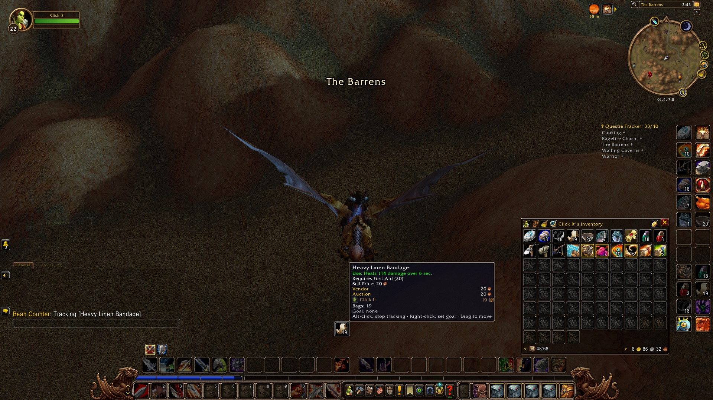

# Bean Counter

**Work in progress — not on CurseForge yet.**

A small bag-item tracker for **World of Warcraft: Forever**. It keeps up to four items on a compact bar, with a live bag count and an optional goal. When you reach the goal the number turns green, and it keeps counting past it. Bags only. No sounds, popups, or flashes. The bar hides when nothing is being tracked.

Free, MIT licensed, written by ClickIT. Nothing is monetized.

**Download:** the [GitHub releases page](https://github.com/xclickitx/BeanCounter/releases) only. This is a work-in-progress first public release; it is not on CurseForge.

The add-on title in-game is **Bean Counter**. The folder, TOC, and Lua file are named `BeanCounterForever` so they do not clash with Auctioneer's **BeanCounter** module (Auctioneer Forever exists for client 1.60.1).

## Screenshots

**Four items on the bar.** A fifth is refused, with a short note in chat.


**Tooltip on a tracked icon:** item name, bag count, goal, and the click hints.



**Goal met.** The count turns green and keeps going past the goal (19 of 18 Heavy Linen Bandage).


**Goal in progress.** The count stays white until you reach it (19 of 20).


## How to use it

- **Alt-right-click** an item in your bags to start tracking it. Alt-right-click the same item again to stop. Chat says "Tracking" or "Removed".
- Shift-click is left alone, so splitting a stack and linking an item into chat still work as usual. Alt-left-click is also left alone, because Bagnon uses it to flash matching items and Auctionator uses it (by default) to pick an item to sell when the auction house is open.
- On the bar:
  - **Hover** — item name, bag count, goal, and "Alt-click: stop tracking · Right-click: set goal · Drag to move"
  - **Right-click** — set or change the goal (type a number, Enter; empty or 0 clears it, Esc cancels)
  - **Alt-click** — stop tracking that item
  - **Left-drag** an icon (when unlocked) — move the bar
- A fifth item is refused, with a short note in chat.
- If you use Bagnon, track from your backpack, not the bank.

## Slash commands

`/beans` is the primary command. `/tally` is an alias. There is no `/bc` alias; that short command is used by other add-ons.

| Command | What it does |
| --- | --- |
| `/beans` | List what you are tracking, or help if the list is empty |
| `/beans help` | This list |
| `/beans add [item]` | Track an item (shift-click it into the chat box). If it is already tracked, chat says "Already tracking" (the bag-click toggle is what removes it). |
| `/beans goal n` | Set a goal on the last item you tracked or clicked |
| `/beans goal [item] n` | Set a goal on that item |
| `/beans remove [item]` | Stop tracking an item (or the last one if you leave the item out) |
| `/beans clear` | Remove every item (the bar hides until you track something again) |
| `/beans lock` | Freeze the bar so it cannot be dragged |
| `/beans unlock` | Allow dragging again |
| `/beans reset` | Move the bar back to the default position |

`/tally` accepts the same commands.

## Install

1. Download `BeanCounter-1.0.2.zip` from the [GitHub releases page](https://github.com/xclickitx/BeanCounter/releases).
2. Close World of Warcraft.
3. Extract the `BeanCounterForever` folder into your WoW Forever add-ons directory:

   `World of Warcraft\_forever_\Interface\AddOns`

   The result must look like:

   `World of Warcraft\_forever_\Interface\AddOns\BeanCounterForever\BeanCounterForever.toc`

   There should not be an extra nested folder (`.../AddOns/BeanCounterForever/BeanCounterForever/...`).

4. Start the game (a `/reload` will not find a brand-new add-on folder; fully restart once).
5. At character select, click AddOns and make sure **Bean Counter** is ticked.

## Compatibility

- **World of Warcraft: Forever**, client **1.60.1**, TOC Interface **16001**.
- Counts use `C_Item.GetItemCount` for bags only (the bank is not included). Bag clicks hook the standard container item button so they also work with Bagnon / BagBrother backpack frames.
- Not tested on Retail, Classic Era, or other flavors, and not advertised for them.

## Folder name

Do not rename the folder to `BeanCounter`. Auctioneer's BeanCounter module uses that folder name and the global `BeanCounter`. This add-on uses `BeanCounterForever` for the folder, TOC, Lua file, and public table, and `BeanCounterCharDB` for its saved variables.

## License

[MIT](LICENSE). Copyright (c) 2026 ClickIT.

## Development

The `test/` folder is a mock harness (Python 3 + [lupa](https://pypi.org/project/lupa/) with Lua 5.1). It is kept in this repository so changes can be checked without launching the game. It is not part of the player zip.

```
cd test
python run.py
```

The suite should report `fails=0`.

**AI Disclaimer:** I used an AI assistant to help write the Lua code and draft this text. I tested every version in-game myself on WoW Forever before releasing it. No AI-generated art or assets are included; the icons are Blizzard's built-in textures, and the screenshots are from the game.
