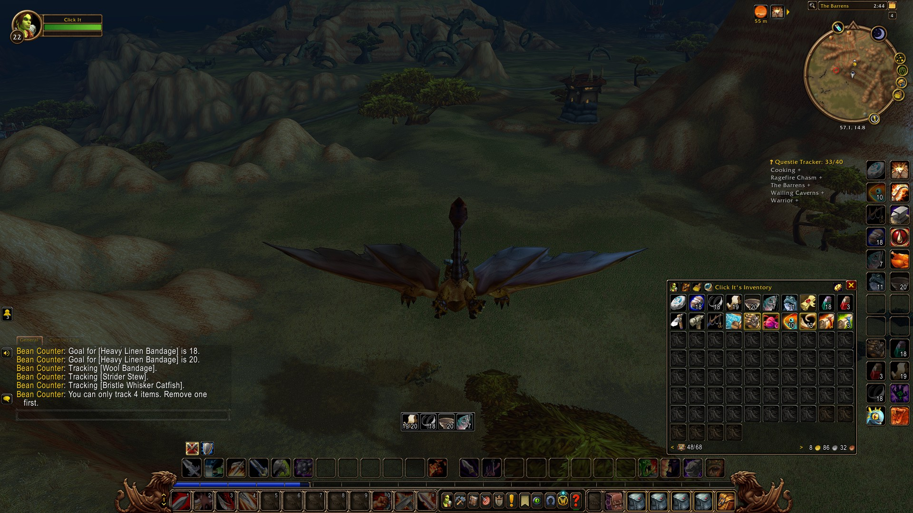
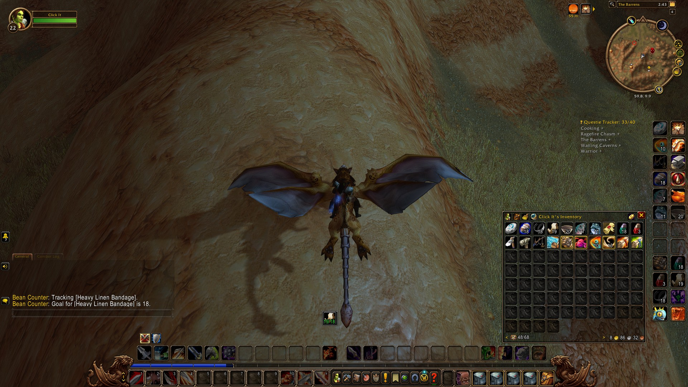
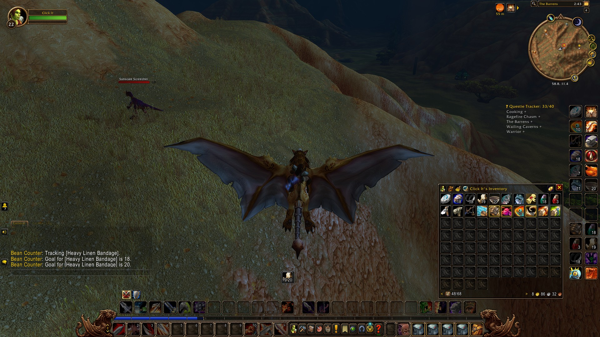

# Needful Slots (formerly Bean Counter)

**Work in progress — not on CurseForge yet.**

**Download:** the [GitHub releases page](https://github.com/xclickitx/NeedfulSlots/releases) only.

A small bag-item tracker for **World of Warcraft: Forever**. It keeps up to four items on a compact bar, with a live bag count and an optional goal. When you reach the goal the number turns green, and it keeps counting past it. Each icon is also a **use button**: left-click it to eat your mage food, open a clam, place a fishbowl, and so on. Bags only. No sounds, popups, or flashes. The bar hides when nothing is being tracked, and items stay on the bar at 0 so a sold stack keeps its slot.

Free, MIT licensed, written by ClickIT. Nothing is monetized.

Until 1.0.2 this add-on was called **Bean Counter** (folder `BeanCounterForever`, commands `/beans` and `/tally`). From 1.0.3 it is **Needful Slots**: folder `NeedfulSlots`, saved variables `NeedfulSlotsCharDB`, commands `/needful` and `/nslots`.

## Screenshots

**Four items on the bar.** A fifth is refused, with a short note in chat.



**Tooltip on a tracked icon:** item name, bag count, goal, and the click hints.


**Goal met.** The count turns green and keeps going past the goal.



**Goal in progress.** The count stays white until you reach it.



(Screenshots are from 1.0.2, when it was still called Bean Counter. The bar looks the same.)

## How to use it

- **Alt-right-click** an item in your bags to start tracking it. Alt-right-click the same item again to stop. Chat says "Tracking" or "Removed".
- Shift-click is left alone, so splitting a stack and linking an item into chat still work. Alt-left-click in your bags is also left alone, because Bagnon uses it to flash matching items and Auctionator uses it (by default) to pick an item to sell.

### Controls on the bar

| Click | What it does |
| --- | --- |
| **Left-click** | Use the item from your bags (eat, drink, open, place). Items with no use do nothing. Equippable items are equipped, the same as a normal bag click. |
| **Right-click** | Set or change the goal (type a number, Enter; empty or 0 clears it, Esc cancels) |
| **Alt-click** | Stop tracking that item. Alt-click never uses the item. |
| **Left-drag** (when unlocked) | Move the bar. Letting go after a drag does not use the item. |
| **Hover** | Item name, bag count, goal, "Left-click: use" when the item has a use (with your key if you bound one), and the other hints |

A fifth item is refused, with a short note in chat. If you use Bagnon, track from your backpack, not the bank.

### Keybinds

Each slot can have its own key. Open **Esc > Options > Keybindings > AddOns** and find the **Needful Slots** header with four bindings: **Use Needful Slot 1**, **Use Needful Slot 2**, **Use Needful Slot 3** and **Use Needful Slot 4** (slot 1 is the leftmost icon). Pressing a key does exactly what a left-click on that icon does: it uses the item.

- Works in combat (it is a secure click, so no taint).
- A key for an empty slot does nothing.
- Keys can be bound with a modifier (for example Alt-1). A key press never stops tracking or opens the goal box, even with Alt held.
- The key follows the slot, not the item: if you untrack an item, the ones after it move left and their keys move with them. In combat the bar does not rearrange, so each key keeps using the item its icon still shows until combat ends.
- The tooltip shows the key, for example "Left-click or Alt-1: use".
- The item is used when you release the key.

### In combat

Using an item from the bar works in combat, and counts, colours and goals keep updating. WoW does not let add-ons change use buttons during combat, so tracking or untracking an item, lock/unlock, reset, and the bar showing or hiding are saved right away but the bar updates when combat ends (chat says so once per fight). The bar cannot be dragged during combat.

## Slash commands

`/needful` is the primary command. `/nslots` is an alias.

| Command | What it does |
| --- | --- |
| `/needful` | List what you are tracking, or help if the list is empty |
| `/needful help` | This list |
| `/needful add [item]` | Track an item (shift-click it into the chat box) |
| `/needful goal n` | Set a goal on the last item you tracked or clicked |
| `/needful goal [item] n` | Set a goal on that item |
| `/needful remove [item]` | Stop tracking an item (or the last one if you leave the item out) |
| `/needful clear` | Remove every item (the bar hides until you track something again) |
| `/needful lock` | Freeze the bar so it cannot be dragged |
| `/needful unlock` | Allow dragging again |
| `/needful reset` | Move the bar back to the default position |

## Install

1. Close World of Warcraft.
2. Extract the `NeedfulSlots` folder into `World of Warcraft\_forever_\Interface\AddOns`, so you get `...\AddOns\NeedfulSlots\NeedfulSlots.toc` (no extra nested folder).
3. **Upgrading from Bean Counter:** delete the old `BeanCounterForever` folder. To keep your tracked items and goals, copy each `WTF\Account\<account>\<realm>\<character>\SavedVariables\BeanCounterForever.lua` to `NeedfulSlots.lua` in the same folder and change the first word `BeanCounterCharDB` to `NeedfulSlotsCharDB`. (If both add-ons are loaded together once, Needful Slots also copies the old settings by itself.)
4. Start the game (a `/reload` will not find a new add-on folder; fully restart once) and make sure **Needful Slots** is ticked in the AddOns list.

## Compatibility

- **World of Warcraft: Forever**, client **1.60.1**, TOC Interface **16001**.
- Key Bindings are secure `CLICK NeedfulSlotsButton1:NeedfulSlotsKey` (to `...4`) bindings in `Bindings.xml`, in the `ADDONS` category.
- Uses `SecureActionButtonTemplate` (`type1 = "item"`), `C_Item.GetItemCount` (bags only), `C_Item.GetItemSpell` / `C_Item.IsUsableItem` for the tooltip hint, and `InCombatLockdown` / `PLAYER_REGEN_ENABLED` for the combat queue. Bag clicks hook the standard container item button, so they also work with Bagnon / BagBrother.
- Not tested on Retail, Classic Era, or other flavors.

## License

[MIT](LICENSE). Copyright (c) 2026 ClickIT.

## Development

The `test/` folder is a mock harness (Python 3 + [lupa](https://pypi.org/project/lupa/) with Lua 5.1, or the `lua5.1` binary if lupa is not installed). It is not part of the player zip.

```
cd test
python run.py
```

The suite should report `fails=0`.

**AI Disclaimer:** I used an AI assistant to help write the Lua code and draft this text. Versions through 1.0.3 have been tested in-game on WoW Forever. No AI-generated art or assets are included; the icons are Blizzard's built-in textures, and the screenshots are from the game.
